# GitDiagram architecture — @konitif/theme

This architecture view was generated from the public repository by [GitDiagram](https://gitdiagram.com/lemouf/konitif-theme) on 2026-09-20 19:02:01 UTC.

It is a documentation projection of the repository tree, README, and source files sampled by GitDiagram. It does not replace the authored contracts in [catalog.json](catalog.json) and [diagrams.json](diagrams.json), nor does it establish runtime authority.

The Mermaid source keeps GitDiagram's groups, nodes, relationships, and source links. GitDiagram's forced color classes and HTML line breaks are omitted so the diagram remains readable in local previews and dark themes.

- Public repository: [konitif-theme](https://github.com/LeMouf/konitif-theme)
- Interactive diagram: [Open in GitDiagram](https://gitdiagram.com/lemouf/konitif-theme)

## Architecture diagram

```mermaid
flowchart TD

subgraph group_theme["Theme Foundation"]
  node_theme_api["Theme API — [konitifTheme.ts]"]
  node_theme_adapter["Theme Adapter"]
  node_base_tokens["Base Tokens — [konitifTokens.css]"]
  node_depth_tokens["Depth Tokens"]
end

subgraph group_runtime["Runtime Visuals"]
  node_runtime_facade["Workbench Runtime"]
  node_phase_visuals["Phase Visual Map"]
  node_spatial_state["Spatial State"]
end

subgraph group_ambient["Ambient Presentation"]
  node_ambient_runtime["Ambient Runtime"]
  node_projection_grid["Projection Grid"]
  node_grid_model["Grid Model"]
  node_ambient_canvas["Ambient Canvas"]
  node_ambient_particles["Ambient Particles"]
end

subgraph group_focus["Focus And Depth"]
  node_focus_store["Focus Store"]
  node_focus_surface["Perceptual Surface"]
  node_focus_provider["Focus Provider"]
  node_depth_stack["Depth Stack"]
  node_depth_layer["Depth Layer"]
end

node_host(("Workbench Host"))

node_host -->|"imports theme"| node_theme_api
node_host -->|"uses runtime"| node_runtime_facade
node_host -->|"loads tokens"| node_base_tokens
node_host -->|"loads depth"| node_depth_tokens
node_runtime_facade -->|"applies theme"| node_theme_adapter
node_theme_adapter -->|"resolves identity"| node_theme_api
node_phase_visuals -->|"creates state"| node_spatial_state
node_runtime_facade -->|"exposes ambient"| node_ambient_runtime
node_runtime_facade -->|"exposes focus"| node_focus_provider
node_ambient_runtime -->|"reads state"| node_spatial_state
node_ambient_runtime -->|"reads focus"| node_focus_store
node_ambient_runtime -->|"renders grid"| node_projection_grid
node_ambient_runtime -->|"renders canvas"| node_ambient_canvas
node_ambient_runtime -->|"renders particles"| node_ambient_particles
node_projection_grid -->|"builds geometry"| node_grid_model
node_focus_surface -->|"updates focus"| node_focus_store
node_focus_provider -->|"provides focus"| node_focus_store
node_depth_layer -->|"uses depth styles"| node_depth_tokens
node_depth_stack -->|"hosts layers"| node_depth_layer

click node_theme_api "https://github.com/lemouf/konitif-theme/blob/main/src/konitifTheme.ts"
click node_theme_adapter "https://github.com/lemouf/konitif-theme/blob/main/src/konitifThemeAdapter.ts"
click node_base_tokens "https://github.com/lemouf/konitif-theme/blob/main/src/konitifTokens.css"
click node_depth_tokens "https://github.com/lemouf/konitif-theme/blob/main/src/depth/spatialDepthTokens.css"
click node_runtime_facade "https://github.com/lemouf/konitif-theme/blob/main/src/konitifWorkbenchThemeRuntime.ts"
click node_phase_visuals "https://github.com/lemouf/konitif-theme/blob/main/src/runtime/runtimePhaseVisualMap.ts"
click node_spatial_state "https://github.com/lemouf/konitif-theme/blob/main/src/runtime/runtimeSpatialReactivity.ts"
click node_ambient_runtime "https://github.com/lemouf/konitif-theme/blob/main/src/ambient/SpatialAmbientRuntime.svelte"
click node_projection_grid "https://github.com/lemouf/konitif-theme/blob/main/src/ambient/SpatialProjectionGrid.svelte"
click node_grid_model "https://github.com/lemouf/konitif-theme/blob/main/src/ambient/spatialProjectionGridModel.ts"
click node_ambient_canvas "https://github.com/lemouf/konitif-theme/blob/main/src/ambient/SpatialAmbientCanvas.svelte"
click node_ambient_particles "https://github.com/lemouf/konitif-theme/blob/main/src/ambient/SpatialAmbientParticles.svelte"
click node_focus_store "https://github.com/lemouf/konitif-theme/blob/main/src/focus/perceptualFocusStore.ts"
click node_focus_surface "https://github.com/lemouf/konitif-theme/blob/main/src/focus/PerceptualSurface.svelte"
click node_focus_provider "https://github.com/lemouf/konitif-theme/blob/main/src/focus/FocusPlaneProvider.svelte"
click node_depth_stack "https://github.com/lemouf/konitif-theme/blob/main/src/depth/SpatialDepthStack.svelte"
click node_depth_layer "https://github.com/lemouf/konitif-theme/blob/main/src/depth/SpatialDepthLayer.svelte"

```

## Generated analysis

@konitif/theme is a Svelte theme and visual-projection library for KONITIF Workbench hosts. The host applies a light or dark theme, supplies runtime phases and focus interactions, and receives themed surfaces plus ambient spatial visuals. Runtime phases become spatial state and visual mappings; ambient rendering projects that state through grids, particles and canvas effects. Perceptual surfaces maintain local focus state, while depth components express layered presentation. Evidence is based on the README, tree, exports and sampled source; several component internals were not sampled.
